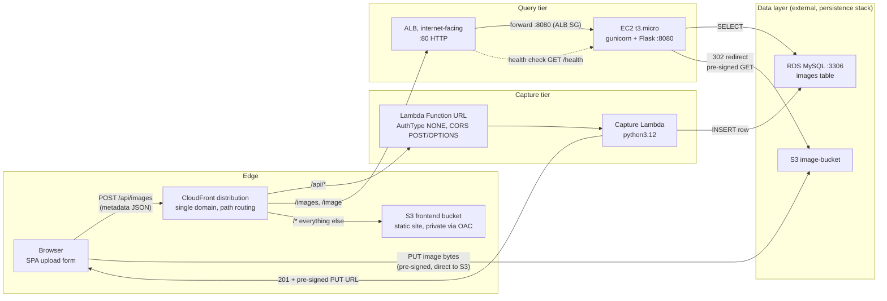

# Photogrammetry

A small image-collection and metadata service. Users upload a photo together
with where, when, and how it was taken; the image bytes go to S3 while the
metadata is stored in RDB and later exposed through a read-only Lambda API.

## What's In The Repository

| Path | Purpose |
| --- | --- |
| `deploy.sh` | Builds the artifacts, deploys the stack, and publishes the frontend |
| `frontend/` | Static upload form (`index.html`, `app.js`, `styles.css`) |
| `lambda/` | Capture service: validates metadata, writes a DB row, returns a pre-signed S3 PUT URL |
| `query/` | Read-only Flask API over the `images` table (`GET /images`, `GET /image`) |
| `templates/` | CloudFormation stacks for the storage layer and the running services |

## Architecture



CloudFront fronts a single domain and routes by path: `/api/*` to the capture
Lambda, `/images` and `/image` to the query service behind an Application Load
Balancer, and all other paths to the static frontend bucket.

## Components

### Frontend (`frontend/`)

A single-page form: pick an image (with local preview), fill in location,
coordinates, altitude, capture time, description, and heading/pitch/roll.
On submit it POSTs the metadata as JSON to `/api/images`, then PUTs the raw
file to the pre-signed URL the API returns. The response is echoed into a
`<pre>` block and to `console.log`.

### Capture Lambda (`lambda/`)

`lambda_function.py` runs on Python 3.12. It:

1. Parses and validates the request body, requiring `location`.
2. Maps fields onto the `images` columns, coercing numerics and
   normalizing `imageDt` (user-supplied capture time) to a MySQL datetime.
3. Stamps `createDt` server-side in UTC.
4. Generates a unique S3 key (`images/<uuid><ext>`) and derives the object URL.
5. Inserts the row, then returns a pre-signed `PUT` URL (`201`) with the
   bucket, key, and expiry. Errors return `400`/`500` JSON.
6. Answers `OPTIONS` preflight requests for CORS.

### Query Service (`query/`)

`app.py` is a Flask app served by gunicorn on a private EC2 instance:

| Route | Behavior |
| --- | --- |
| `GET /health` | Liveness check |
| `GET /images` | Filtered listing of metadata rows |
| `GET /image?url=<s3url>` | Validates the stored URL, then 302-redirects to a short-lived pre-signed GET URL |

`/images` supports range filters (`latitudeMin/Max`, `longitudeMin/Max`,
`altitudeMin/Max`, `headingMin/Max`, `pitchMin/Max`, `rollMin/Max`,
`horizontalAccuracyMin/Max`), datetime filters (`imageDt`/`createDt` with
`Since`/`Before` suffixes), substring filters (`location`, `description`), an
exact `s3url` match, a `bbox=minLon,minLat,maxLon,maxLat` bounding box,
`orderBy` + `order`, and `limit`/`offset` paging. Numbers, datetimes, and
`Decimal` values are serialized with datetimes rendered as ISO-8601 UTC (`Z`).

### Infrastructure (`templates/`)

`ImageServiceInfrastructrure.yaml` is the deployed stack. It provisions the
frontend S3 bucket plus origin access control, the Lambda and its Function URL,
the CloudFront distribution and routing rules, and the query tier (security
groups, EC2 instance, ALB, target group, listener). Key resources are exposed
as stack outputs (`FrontendURL`, `CaptureEndpoint`, `QueryAlbDnsName`,
`QueryImagesEndpoint`, and others).

`ImagePersistanceInfrastructrure.yaml` is an early draft of the storage layer
(bare S3 bucket + RDS instance) and is not part of the deployed stack.

## Deployment

`deploy.sh` builds the artifacts, deploys `templates/ImageServiceInfrastructrure.yaml`,
and publishes the frontend. The stage argument selects how much of that it does:

| Stage | Builds | Deploys stack | Syncs frontend |
| --- | --- | --- | --- |
| `all` (default) | capture + query | yes | yes |
| `lambda` | capture | yes | no |
| `query` | query | yes | no |
| `frontend` | nothing | no | yes |

```bash
# Everything: capture Lambda, query tier, and frontend
DB_HOST=<rds-endpoint> DB_PASSWORD=<password> \
  QUERY_VPC_ID=<vpc> QUERY_SUBNET_ID=<subnet> \
  ALB_SUBNET_IDS=<subnet-a>,<subnet-b> \
  ./deploy.sh all

# Just the capture Lambda after editing lambda_function.py
DB_HOST=<rds-endpoint> DB_PASSWORD=<password> ./deploy.sh lambda

# Just re-publish the static frontend
./deploy.sh frontend
```

`DB_HOST`, `DB_PASSWORD`, `QUERY_VPC_ID`, `QUERY_SUBNET_ID`, and `ALB_SUBNET_IDS`
are required for the stages that touch the query tier. A stage that finds no
existing stack is upgraded to a cold start, which builds both artifacts and
requires all five, because the VPC and subnet parameters have no defaults.

Artifacts are uploaded under content addressed keys (`capture-<hash>.zip`,
`query-<hash>.zip`) derived from the source files. That is what makes a
redeploy take effect: a changed key changes the Lambda code reference and the
query instance's user data, and the user data change replaces the instance so
it installs the new code. Replacing that instance leaves the query routes
unhealthy for a few minutes while it bootstraps, so the script waits for
`/health` afterwards (set `SKIP_HEALTH_WAIT=1` to skip).

`AWS_REGION`, `STACK_NAME`, `ARTIFACT_BUCKET`, `LAMBDA_CODE_KEY`,
`QUERY_CODE_KEY`, and other overrides are documented at the top of `deploy.sh`.

## Database Definition

```sql
CREATE TABLE images (
    `s3url` VARCHAR(256) CHARACTER SET ascii NOT NULL,
    `location` VARCHAR(255) DEFAULT NULL,
    `latitude` DECIMAL(9,6) DEFAULT NULL,
    `longitude` DECIMAL(9,6) DEFAULT NULL,
    `altitude` DECIMAL(9,2) DEFAULT NULL,
    `horizontalAccuracy` DECIMAL(9,2) DEFAULT NULL,
    `imageDt` DATETIME DEFAULT NULL,
    `description` TEXT,
    `heading` DECIMAL(6,2) DEFAULT NULL,
    `pitch` DECIMAL(6,2) DEFAULT NULL,
    `roll` DECIMAL(6,2) DEFAULT NULL,
    `createDt` TIMESTAMP NOT NULL DEFAULT CURRENT_TIMESTAMP,
    PRIMARY KEY (`s3url`),
  )
```
